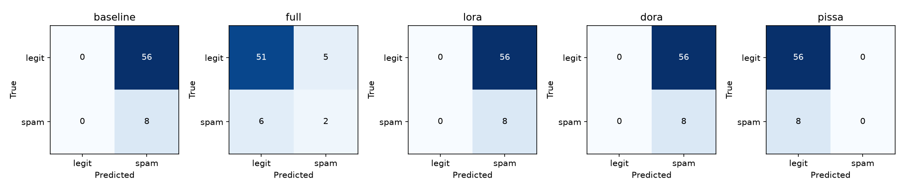

# lowrank-lab

**LoRA, DoRA, and PiSSA implemented from scratch in PyTorch.**

[](https://github.com/hardik17906/lowrank-lab/actions/workflows/ci.yml)
[](LICENSE)
[](pyproject.toml)

This repository studies how low-rank parameterizations change fine-tuning
behavior: initialization, gradient flow, convergence, parameter count, and
memory. The adapter forward passes are ordinary PyTorch code. Hugging Face
provides pretrained architectures and tokenizers; PEFT is used only for
independent numerical validation.

[Research report](reports/RESEARCH_REPORT.md) ·
[Reproduction guide](reports/REPRODUCTION_GUIDE.md) ·
[Recorded benchmark](benchmarks/sms-pilot-2026-10-28/README.md) ·
[Learning guide](learning/COMPLETE_LEARNING_GUIDE.md)

## Implementations

| Method | What is trained | Implementation detail |
|---|---|---|
| LoRA | Low-rank factors A and B | Frozen base, alpha/r scaling, zero initial update |
| DoRA | Direction factors and output-channel magnitudes | Correct normalization axes; detached or fully differentiated denominator |
| PiSSA | Principal-component factors | Scale-correct SVD initialization and a frozen residual that preserves the starting function |

All three support configurable placement/rank, adapter-only checkpoints,
inference merging, and restoration to ordinary linear layers. The tests cover
initialization, gradients, merge equivalence, reconstruction, dtype conversion,
causal masking, accumulation, and exact CPU checkpoint resume.

The code also includes a small decoder-only Transformer for inspecting tensor
shapes and training mechanics. Its synthetic examples are kept separate from
the pretrained downstream study.

## Results: a short-budget SMS pilot

The recorded study uses **SmolLM2-135M**, a pinned model revision, and
deduplicated UCI SMS data. The main comparison holds the split, prompt,
tokenization, seed, optimizer, learning rate, and 12-step budget fixed.
There are 128 training, 32 validation, and 64 test examples. Memory values
come from separate processes on a 4 GiB GTX 1650 Ti.

| Method | Test CE ↓ | Accuracy | Macro F1 | Trainable parameters | Peak GPU MiB |
|---|---:|---:|---:|---:|---:|
| No fine-tuning | 9.267 | 12.5% | 0.111 | 0 | — |
| Full fine-tuning | 0.370 | 82.8% | 0.585 | 134,515,008 | 2,671 |
| LoRA | 7.617 | 12.5% | 0.111 | 460,800 | 799 |
| DoRA | 7.374 | 12.5% | 0.111 | 506,880 | 1,003 |
| PiSSA | 0.997 | 87.5% | 0.467 | 460,800 | 801 |



**These are pilot observations, not a method ranking.** PiSSA predicts the
majority class throughout this test set; its accuracy does not establish
useful spam detection. Gaussian-initialized LoRA also reduces loss rapidly,
showing that factor scale matters when interpreting early convergence.
The test set contains only eight spam messages, and the shared hyperparameters
are not independently tuned for each method.

The [benchmark snapshot](benchmarks/sms-pilot-2026-10-28/README.md) contains
32 completed runs: CPU demonstrations, pretrained baselines, rank/placement/
data-size/initialization ablations, seed repeats, and isolated memory repeats.
It includes real metrics, histories, predictions, split fingerprints, and
artifact hashes. Model weights and local execution files are not committed.

## Quick start

Python 3.10 or later is required; the recorded environment used Python 3.12.
Run these commands from a fresh clone:

```bash
git clone https://github.com/hardik17906/lowrank-lab.git
cd lowrank-lab
python -m venv .venv
```

Activate the environment with `source .venv/bin/activate` on Linux/macOS, or
`.\.venv\Scripts\Activate.ps1` in PowerShell. Then:

```bash
python -m pip install torch --index-url https://download.pytorch.org/whl/cpu
python -m pip install -e ".[dev,reference]"
python -m pytest -q
python -m lowrank_lab run --config configs/smoke.yaml
```

The smoke run needs no model download or GPU. CUDA-only tests skip on a CPU
build. On the recorded CUDA environment, all **60 tests passed**, including
three independent PEFT forward/gradient comparisons.

## Pretrained experiments

```bash
python -m lowrank_lab prepare --config configs/pretrained_cpu.yaml --allow-download
python -m lowrank_lab run --config configs/lora.yaml
python -m lowrank_lab run --config configs/dora.yaml
python -m lowrank_lab run --config configs/pissa.yaml
```

Use `configs/baseline.yaml` and `configs/full_finetune.yaml` for the controls.
The GPU pilot is configured in `configs/pretrained_gpu.yaml`. Candidate 0.5B
and 1.5B configurations are provided for larger experiments; they were not run
in the recorded study. Resource guards do not guarantee that every model fits.

Generate an ablation before launching it:

```bash
python -m lowrank_lab grid --base configs/pretrained_gpu.yaml --stage rank --output configs/experiments/my_rank_study
python -m lowrank_lab suite --manifest configs/experiments/my_rank_study/manifest.json --limit 1
```

Each suite run uses a separate process. Completed outputs are protected from
overwrite. See the [reproduction guide](reports/REPRODUCTION_GUIDE.md) for
resume, evaluation, all study axes, and Windows/Linux setup.

## Inspect the evidence without training

```bash
python scripts/verify_benchmark.py
python -m lowrank_lab analyze --root benchmarks/sms-pilot-2026-10-28/runs --output reports/figures
```

The verifier checks the published file hashes, encoded split integrity,
record counts, and metrics recomputed from predictions. It does not claim
to verify model weights, which are intentionally excluded.

## Code map

```text
src/lowrank_lab/
  adapters/      # Explicit weight parameterizations, injection, merge, checkpoints
  models/        # Educational decoder and pretrained-model loading
  data/          # Deduplication, split policy, tokenization and loss masks
  training/      # Token-weighted accumulation, scheduling and deterministic resume
  evaluation/    # Conditional answer scoring, CE/PPL, accuracy and macro F1
  experiments/   # Configs, isolated runs, ablations and analysis
benchmarks/      # Immutable recorded results; new runs go to ignored results/
tests/           # Numerical, functional and reference checks
learning/        # Derivations, worked examples and a function-by-function walkthrough
```

The [code walkthrough](learning/PROJECT_CODE_WALKTHROUGH.md) follows a batch
from data preparation through forward, backward, optimizer step, checkpoint,
and evaluation. [PROJECT_HANDOFF.md](PROJECT_HANDOFF.md) provides a detailed
implementation and execution reference.

## Scope and attribution

Supported integration targets are unquantized `nn.Linear` projections with
Llama/Qwen/OPT-style mappings. Quantization, arbitrary fused QKV/Conv1D layers,
distributed training, and adaptive-rank allocation are outside this version.
This is a method implementation and small experimental study, not a full
reproduction of the papers' large-model benchmarks.

The original methods are [LoRA](https://arxiv.org/abs/2106.09685),
[DoRA](https://arxiv.org/abs/2402.09353), and
[PiSSA](https://arxiv.org/abs/2404.02948). Data is from Almeida and Hidalgo's
[SMS Spam Collection](https://doi.org/10.24432/C5CC84), licensed CC BY 4.0.
See [the source audit](reports/SOURCES.md) for conventions and deliberate
differences, and [third-party notices](THIRD_PARTY_NOTICES.md) for attribution.

Source code is [MIT-licensed](LICENSE). Contributions should follow
[CONTRIBUTING.md](CONTRIBUTING.md); citation metadata is in [CITATION.cff](CITATION.cff).
